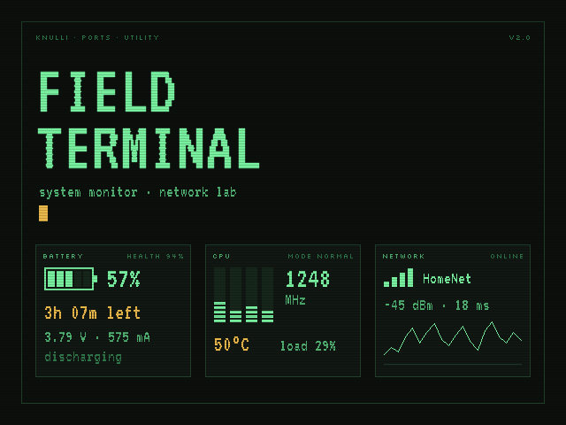
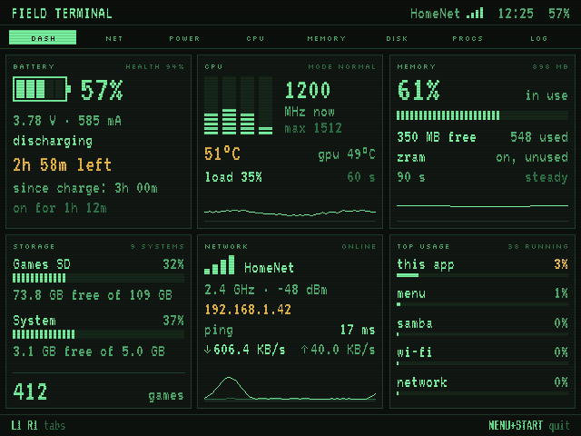
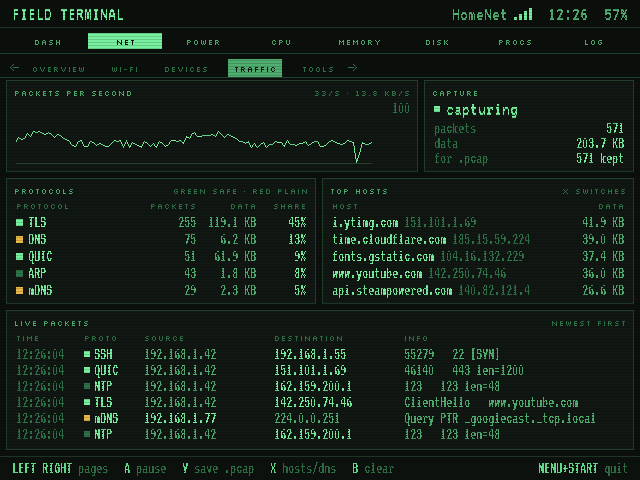
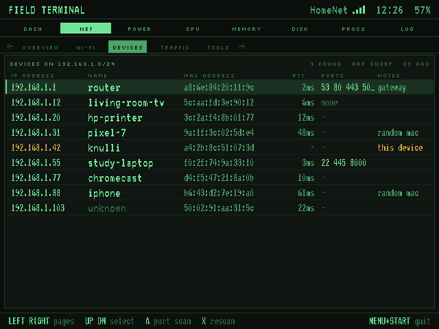
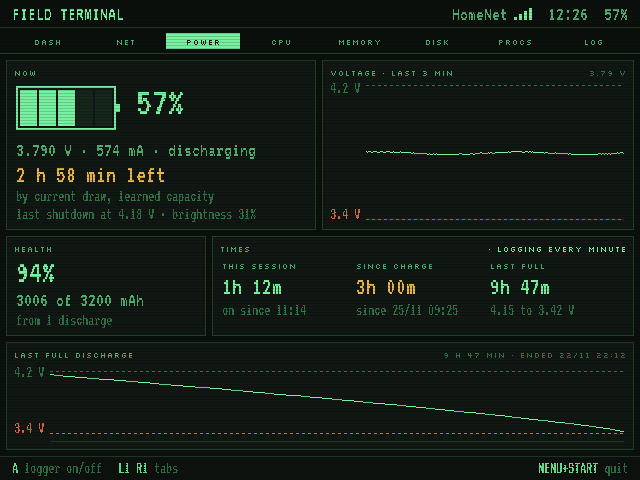
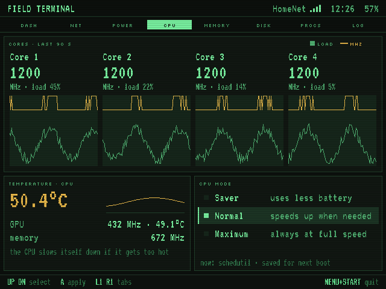
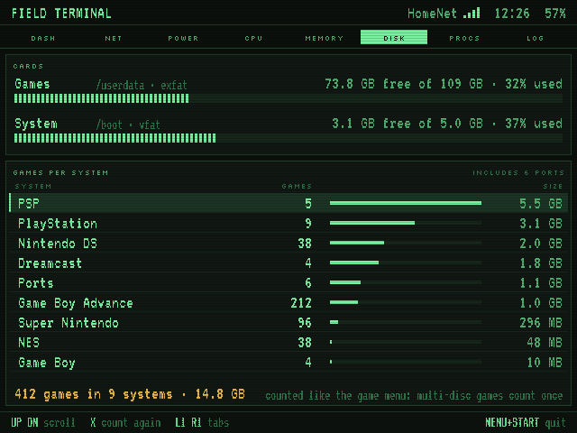
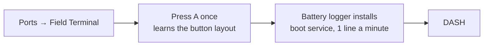
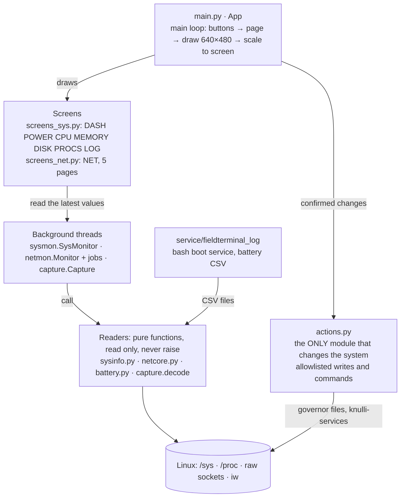
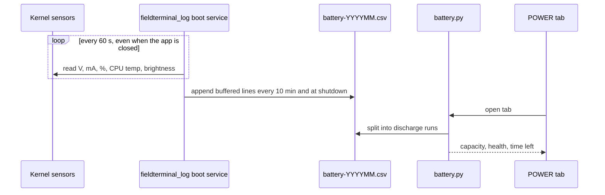

<p align="center">
  
</p>

<h1 align="center">Field Terminal</h1>

<p align="center">
  A pocket system monitor and network lab for the Anbernic RG40XXH running Knulli.
</p>

<p align="center">
  
  
  
  
</p>

---

Field Terminal is a Ports app for the RG40XXH. Open it from the Ports menu and it shows you what your handheld is doing:

- **Battery:** how long the charge will last, and whether the battery is wearing out
- **CPU:** speed, load and temperature per core
- **Memory and storage:** RAM, ZRAM, free space on each card, and how many games you have per system
- **Network:** a Wi-Fi scanner, device discovery, a port scanner, live packet capture with `.pcap` export, plus ping, traceroute and DNS tests

It's about 5,500 lines of Python plus pygame, and both already come with Knulli, so you don't install anything else. Everything is drawn on a 640×480 canvas in green phosphor, made for the handheld's screen and controls.

> [!IMPORTANT]
> **Read this before you install.**
> - On first launch, Field Terminal installs a small **boot service** (`fieldterminal_log`) that writes a line about the battery once a minute, even when the app is closed. Its history is what makes battery health and time left possible. To turn it off, open the POWER tab and press **A**. [Uninstall](#uninstall) removes it completely.
> - Like every Knulli port, it **runs as root**. That's how packet capture and the device scan get raw sockets.
> - Only scan or capture on **networks you own or have permission to test**.

## Screenshots

<table>
  <tr>
    <td></td>
    <td></td>
  </tr>
  <tr>
    <td align="center"><sub>DASH: everything at a glance</sub></td>
    <td align="center"><sub>NET › Traffic: live capture, save as .pcap</sub></td>
  </tr>
  <tr>
    <td></td>
    <td></td>
  </tr>
  <tr>
    <td align="center"><sub>NET › Devices: ARP sweep, then press A to port scan</sub></td>
    <td align="center"><sub>POWER: time left and battery health</sub></td>
  </tr>
  <tr>
    <td></td>
    <td></td>
  </tr>
  <tr>
    <td align="center"><sub>CPU: per-core load and CPU mode</sub></td>
    <td align="center"><sub>DISK: space and games per system</sub></td>
  </tr>
</table>

<sub>All screenshots come from demo mode, so the network, devices and traffic are made up. More screens are in <a href="previews/"><code>previews/</code></a>.</sub>

## What each tab answers

| Tab | Question | What you see |
|---|---|---|
| **DASH** | Is everything OK? | battery and time left, CPU, memory, storage and game count, network, top programs |
| **NET** | Is my network OK, and what's on it? | five pages: Overview, Wi-Fi, Devices (A = port scan), Traffic (live capture, Y = save `.pcap`), Tools (ping, traceroute, DNS, button setup) |
| **POWER** | How long will it last? Is the battery wearing out? | %, V, mA, time left, a 3-minute voltage graph, time since charge, health, the last full discharge curve. A = logger on/off |
| **CPU** | Why is it slow or hot? | speed and load per core (90 s), CPU and GPU temperature, CPU mode Saver / Normal / Maximum |
| **MEMORY** | Will this game run smoothly? | RAM in use (90 s), ZRAM. A = ZRAM at boot, X = start/stop now |
| **DISK** | Do I have room for more games? | each card, plus games and size per system |
| **PROCS** | What is using the CPU? | top programs by CPU and memory (read only) |
| **LOG** | What happened? | events, also saved to `logs/fieldterminal-YYYYMMDD.log` |

### Controls

| Button | Does |
|---|---|
| **L1 / R1** | switch tab (left / right does too, on tabs without pages) |
| **Left / Right** | switch page in the NET tab |
| **Up / Down** | move through lists |
| **A** | the tab's main action (each one is shown in the footer) |
| **B** | back / cancel |
| **X / Y** | the tab's extra actions (shown in the footer) |
| **MENU + START** | quit |

## Install on the RG40XXH

### What you need

- An RG40XXH running **[Knulli](https://knulli.org)**. Tested on Knulli **Scarab 20260511**, whose Python 3.12.8 and pygame 2.5.2 are built in.
- **PortMaster**, which comes with Knulli. The launcher uses its controller mapping, so it won't start without it.
- Wi-Fi turned on, if you want to use the NET tab.

Other 640×480 Knulli handhelds will probably work but haven't been tested. If you try one, please [report back](#contributing).

### Option A: copy files to the SD card

1. Download this repo: **Code → Download ZIP**, or `git clone https://github.com/gourab026/field-terminal.git`.
2. Power off the handheld, take out the card that holds your games and put it in your PC. That's either the `SHARE` partition on the card in TF1, or the card in TF2 if your games are on a second card.
3. Copy these two items from the repo's `ports/` folder into the card's `roms/ports/` folder:

   ```
   ports/fieldterminal/          →  roms/ports/fieldterminal/
   ports/Field Terminal.sh       →  roms/ports/Field Terminal.sh
   ```

4. Put the card back, start the handheld, and go to **Menu → Game settings → Update gamelists**.
5. Open **Ports → Field Terminal**.

### Option B: copy over Wi-Fi (no card swapping)

Knulli shares its storage on your network as `share`. Its default login is `root` / `linux`.

| From | Address |
|---|---|
| Windows | `\\<handheld-ip>\share` in Explorer |
| macOS | Finder → Go → Connect to Server → `smb://<handheld-ip>/share` |
| Linux | `smb://<handheld-ip>/share` in your file manager |

Copy the same two items into `share/roms/ports/`, then do steps 4–5 above. The handheld's IP is in **Menu → Network settings**.

### First launch



- The first time, it asks you to press **A** once. Some handhelds report the A button as SDL's "B", so this is how it learns which layout yours uses. You can redo it later in NET → Tools.
- Battery health needs some history first. It shows up after a discharge that uses at least 30% of the battery over at least 30 minutes.

### Optional: cover art in the Ports menu

`ports/fieldterminal/gameinfo.xml` holds a ready-made `<game>` entry with a description, cover and screenshot. Paste it into `roms/ports/gamelist.xml` before `</gameList>`. Do it with the card in your PC, because EmulationStation rewrites game lists from memory while it's running.

### Uninstall

1. In Field Terminal, open the POWER tab and press **A** to stop the logger and remove it from boot. Over SSH you can run `knulli-services disable fieldterminal_log` instead.
2. Delete these, all relative to `/userdata` (the `share` folder):

   | Path | What it is |
   |---|---|
   | `roms/ports/fieldterminal/` | the app, your settings, logs and captures |
   | `roms/ports/Field Terminal.sh` | the launcher |
   | `system/services/fieldterminal_log` | the boot service |
   | `system/fieldterminal/` | battery history CSVs |

3. Go to **Menu → Game settings → Update gamelists**.

---

## How it works

This section is the design doc. For a file-by-file walkthrough with line counts, see **[ARCHITECTURE.md](ARCHITECTURE.md)**.

### Goals

- **Answer the everyday questions at a glance:** will the battery last, why is it hot, is there room, is the Wi-Fi OK.
- **Be a real network lab that fits in a pocket:** discovery, port scan, capture, ping, traceroute and DNS, all controller-driven.
- **Install nothing.** Use only the Python standard library and the pygame that Knulli already ships.
- **Be safe to leave running.** It's read-only by default and never closes because one sensor is missing.
- **Be gentle on battery and SD card.** Redraw only when something changed, sample expensive things only when they're on screen, and batch writes.

### Non-goals

- Killing processes, overclocking, or changing voltages or speed limits. PROCS is read only, and CPU mode only picks among the kernel's own governors.
- Monitor mode or capturing other devices' traffic. The RG40XXH's Wi-Fi chip (rtl8821cs) has no monitor mode, so capture sees only the handheld's own traffic plus broadcasts.
- Scanning anything outside your local network.

### Constraints

| Constraint | Why it matters |
|---|---|
| Allwinner H700, 4× Cortex-A53, about 1 GB RAM | the UI thread must never wait on I/O, and history buffers are capped |
| 640×480 screen, no touch, no keyboard | everything is reachable with the d-pad, A/B/X/Y and the shoulder buttons |
| Python 3.12 + pygame 2.5 on the device, no pip | standard library only, and no syntax or APIs newer than 3.12 / pygame 2.5 |
| Ports launch as root | raw sockets are available, so every write has to be explicitly allowed |
| SD card storage | logs are buffered in memory and written in batches |

### Architecture: four layers



Two rules run through the code:

1. **Everything is read-only except `actions.py`.** Screens never write files or run commands themselves. They ask `actions.py`, which checks every file write against `ALLOWED_WRITES` and every command against `ALLOWED_CMDS`, and raises `Refused` for anything else.
2. **One bad value can't close the app.** Readers return `None` instead of raising. Each thread and each page's `draw()` is wrapped in try/except. A failing page shows an error tile and logs to the LOG tab while every other tab keeps working.

### Startup

```
Ports menu → "Field Terminal.sh" (root)
  ├─ sources PortMaster's control.txt → SDL controller mapping for this handheld
  ├─ cd /userdata/roms/ports/fieldterminal
  └─ python3 main.py > log.txt 2>&1      # any crash ends up in log.txt
        └─ App() → App.run()             # until MENU + START
```

### Main loop and rendering

`App.run` runs 30 times a second:

1. **Input.** `inputs.Input` turns SDL controller and keyboard events into action names (`"a"`, `"l1"`, `"left"`…) and handles d-pad repeat.
2. **Dispatch.** `App.handle` checks for MENU + START first, then an open confirm dialog, then tab switching, and otherwise passes the action to the current page's `handle()`.
3. **Redraw only when needed.** A page redraws when it's marked `dirty` or when its timer runs out: 1 s on most tabs, 0.5 s on NET, 0.1 s while a scan runs.
4. **Draw** on a fixed 640×480 canvas in this order: header, tab bar, page, scanlines, footer hints, toast, dialog. The canvas is then scaled to the real display.

Each page is a small class with `enter()`, `leave()`, `handle()` and `draw()`. `enter` and `leave` switch the expensive data sources on and off. Process sampling runs only on DASH and PROCS, packet capture only while NET is open, and the Wi-Fi scan and device sweep start the first time you open their page.

### Threads and data flow

The UI thread never blocks. Background threads sample on their own schedule and keep the latest value plus a short history, and pages just read them:

| Source | Interval | Thread |
|---|---|---|
| battery, CPU load and frequency, memory | 1 s | `sysmon.SysMonitor` |
| governor, brightness | 5 s | `sysmon.SysMonitor` |
| processes (only on DASH and PROCS) | 2 s | `sysmon.SysMonitor` |
| disks | 15 s | `sysmon.SysMonitor` |
| game counts per system | on change (folder mtime), cached in `cache.json` | background job |
| link speed, signal, gateway and internet ping | 1 s (slower when NET isn't shown) | `netmon.Monitor` |
| DNS check | 20 s | `netmon.Monitor` |
| Wi-Fi scan, ARP sweep, port scan, tools | on demand | `netmon` jobs |
| packets (only while NET is open) | continuous, ring buffer of 6,000 frames | `capture.Capture` |

Battery health comes from two separate processes: the boot service collects the data and the app analyses it.



### How the features work

| Feature | How |
|---|---|
| **CPU load** | reads `/proc/stat` twice and compares the counters: the share of time between the two readings that wasn't idle, per core. Per-process CPU uses `/proc/<pid>/stat` the same way |
| **Battery capacity** | for each continuous discharge run of at least 30% over at least 30 min, adds up current × time (trapezoid rule) and divides by the % used |
| **Battery health** | median of the last 5 capacities ÷ design capacity (3200 mAh on the RG40XXH, unless the battery reports its own) |
| **Time left** | % left × capacity ÷ average current over the last 2 min. Without a current sensor it uses % left ÷ % lost per hour |
| **Device discovery** | hand-built ARP "who has" broadcasts for every address in the subnet, sent through an `AF_PACKET` raw socket. Replies give MAC addresses, randomized MACs are flagged, and names come from reverse DNS. Without root it falls back to a parallel ping sweep plus the kernel ARP cache |
| **Port scan** | a TCP connect() scan with up to 48 non-blocking sockets under `select()`, then banner grabs (SSH, FTP and SMTP greetings, HTTP `HEAD`). **Refuses any non-private IP** |
| **Packet capture** | an `AF_PACKET` / `ETH_P_ALL` socket, decoding Ethernet → IPv4/IPv6 → TCP/UDP/ICMP/ARP by hand with `struct`. Hostnames are learned from DNS answers and the TLS ClientHello SNI. **Y** saves a classic libpcap file you can open in Wireshark |
| **CPU mode** | Saver = `conservative`/`powersave`, Normal = `schedutil`/`ondemand`, Maximum = `performance` (asks first), saved with `knulli-settings-set system.cpu.governor` like the Knulli menu does |
| **ZRAM** | Knulli's own `zramswap` service. Stopping it is refused if free RAM couldn't take back what ZRAM holds |
| **Game counts** | reads EmulationStation's system list and counts files with each system's extensions. Files listed inside a `.cue`, `.m3u` or `.gdi` count as one game |

### Files it creates on the handheld

Relative to `/userdata`:

| Path | What it is |
|---|---|
| `roms/ports/fieldterminal/config.json` | button layout, logger on/off |
| `roms/ports/fieldterminal/cache.json` | game counts per system |
| `roms/ports/fieldterminal/logs/` | event logs and `sensors.txt` (a sensor report written at start) |
| `roms/ports/fieldterminal/captures/*.pcap` | saved captures |
| `roms/ports/fieldterminal/log.txt` | the last run's Python output, for crash reports |
| `system/services/fieldterminal_log` | the boot logger service |
| `system/fieldterminal/battery-*.csv` | battery history (the last 6 months are kept) |

## Project layout

```
field-terminal/
├── ports/                       ← exactly what goes in roms/ports/ on the card
│   ├── Field Terminal.sh        launcher (PortMaster controls → python3 main.py)
│   └── fieldterminal/
│       ├── main.py              App: loop, header/tabs/footer, toasts, dialogs, first run
│       ├── inputs.py            controller/keyboard → action names, d-pad repeat
│       ├── theme.py             fonts, palette, glow, scanlines, bars, graphs
│       ├── screens_sys.py       DASH POWER CPU MEMORY DISK PROCS LOG
│       ├── screens_net.py       NET: Overview, Wi-Fi, Devices, Traffic, Tools
│       ├── sysinfo.py           readers for /sys and /proc
│       ├── sysmon.py            SysMonitor thread + history
│       ├── battery.py           CSV parsing, capacity, health, time left
│       ├── netcore.py           routes, Wi-Fi, ping, ARP sweep, port scan, DNS
│       ├── netmon.py            network threads and jobs, event log
│       ├── capture.py           raw-socket capture, decoding, .pcap export
│       ├── actions.py           the only writer (allowlisted)
│       ├── demo.py              fake data for --demo and screenshots
│       ├── service/fieldterminal_log   bash boot service (battery logger)
│       ├── fonts/               VT323, Silkscreen (SIL OFL)
│       └── gameinfo.xml, cover.png, screenshot.png   Ports menu entry and art
├── tests/                       pytest, against a fake /sys and /proc tree
├── tools/
│   ├── deploy.py                install over SSH or SMB from a PC (see below)
│   └── make_art.py              draws cover.png
├── previews/                    every screen, rendered from demo mode
└── ARCHITECTURE.md              file-by-file walkthrough
```

## Development

You don't need the handheld to work on most of the code.

### Setup

Use **Python 3.12** if you can, since that's what the device runs. Newer Python accepts syntax that will break on the handheld.

```bash
git clone https://github.com/gourab026/field-terminal.git
cd field-terminal
python3.12 -m venv .venv && . .venv/bin/activate
pip install "pygame>=2.5,<2.7" pytest
```

### Run it on your PC

```bash
cd ports/fieldterminal
python3 main.py --demo          # made-up data, in a 2× window
```

| Key | Button | | Key | Button |
|---|---|---|---|---|
| arrows | d-pad | | Q / E | L1 / R1 |
| Enter or Z | A | | Space | START |
| Esc or X | B | | M | MENU |
| C | X | | Tab | SELECT |
| V | Y | | F10 | quit |

Running without `--demo` on a Linux PC shows your PC's real sensors. Raw-socket features need root and fall back to safer methods without it. System changes (CPU mode, ZRAM, the logger) are switched off unless it runs as root on Knulli. In demo mode they're only simulated.

### Render every screen to PNG

```bash
cd ports/fieldterminal
SDL_VIDEODRIVER=dummy python3 main.py --screens ../../previews
```

This is how `previews/` is made. Re-run it when you change the UI and commit the new images with your change.

### Tests

```bash
python3 -m pytest -q
```

The suite currently has 60 tests. `FT_SYSROOT` puts a prefix in front of every `/sys` and `/proc` path, so `tests/conftest.py` can build a fake RG40XXH sensor tree in a temp folder and the readers run against it. The bash logger is tested the same way through `FT_SYSROOT`, `FT_DATA`, `FT_RUN` and `FT_INTERVAL`. If you add a reader, add the sensor files it needs to `conftest.py`.

### Deploy to your handheld from a PC: `tools/deploy.py`

```bash
ssh-copy-id root@<handheld-ip>                     # once; Knulli's default password is "linux"
python3 tools/deploy.py <handheld-ip> probe        # read-only report: sensors, governors, Python, ports folder
python3 tools/deploy.py <handheld-ip> install      # stage, compile-check, keep settings, swap folders
python3 tools/deploy.py <handheld-ip> smb-install  # the same over the SMB share, no SSH
python3 tools/deploy.py <handheld-ip> smb-fetch    # copy logs, sensor report and battery CSVs to the PC
```

It was written for the author's own setup, so keep three things in mind:

- It also **removes "Net Analyzer"**, the app Field Terminal replaced (`roms/ports/netanalyzer` and `Net Analyzer.sh`). If you don't have it, nothing happens.
- It saves backups to a `card-backups/` folder **next to** your clone, not inside it.
- SSH uses only `~/.ssh/id_ed25519`, with your agent turned off.

`probe` is the quickest way to find out whether a new handheld's sensors are readable. Paste its output into an issue.

## Contributing

Contributions are welcome, whether it's a bug report from your own handheld, a fix, or support for another device.

**Useful places to start**

- **Run it on another Knulli handheld** and report what works. Battery and thermal sensor names differ between devices, and `probe` output or `logs/sensors.txt` is exactly what helps.
- **Bugs:** open an issue with what you did, what you expected, and the contents of `roms/ports/fieldterminal/log.txt` and the newest file in `logs/`.
- **Features:** open an issue first so we can agree on where it fits before you write it. The tab structure is deliberate: each tab answers one question.

**Before you open a pull request**

- [ ] Standard library and pygame only, with nothing newer than **Python 3.12 / pygame 2.5**.
- [ ] New readers are read-only, return `None` instead of raising, and come with a test in `tests/`.
- [ ] Anything that changes the system goes through `actions.py` and its allowlists. Ask for confirmation in the UI if the change is risky.
- [ ] Network features stay limited to private addresses.
- [ ] `python3 -m pytest -q` passes.
- [ ] If the UI changed, regenerate `previews/` and check it at 640×480.
- [ ] Update this README or `ARCHITECTURE.md` if the behaviour changed.

Keep pull requests small and focused. One feature or fix per PR is easiest to review.

## Responsible use

Device discovery, port scanning and packet capture are for learning and troubleshooting **your own networks**. The port scanner refuses public addresses, and the Wi-Fi chip can't see other devices' private traffic, but you're still responsible for where you point it. Scanning networks without permission may be illegal where you live.

## Credits and license

- Fonts: [VT323](https://fonts.google.com/specimen/VT323) and [Silkscreen](https://fonts.google.com/specimen/Silkscreen), both under the SIL Open Font License. See `ports/fieldterminal/fonts/LICENSE-*.txt`.
- Controller mapping by [PortMaster](https://portmaster.games).
- Built for [Knulli](https://knulli.org).

Field Terminal is released under the [MIT License](LICENSE).
